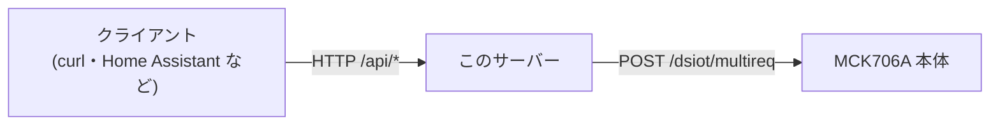
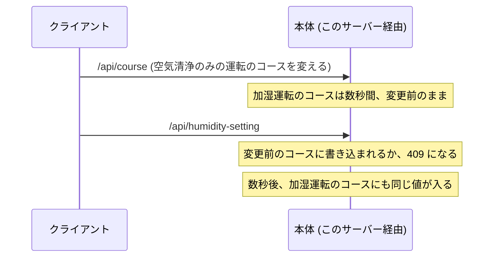

# Daikin MCK706A API

[](https://github.com/msageha/daikin-air-purifier-MCK706A-W/actions/workflows/ci.yaml)

ダイキンの加湿空気清浄機 **MCK706A-W** を、同じ LAN から HTTP で監視・操作する REST サーバーです。
公式アプリが LAN 内で使う、仕様が公開されていない本体の API (`/dsiot/multireq`) を、扱いやすい JSON の API に変換します。クラウドは経由しません。



| できること | 対象                                                                  |
| ---------- | --------------------------------------------------------------------- |
| 読み取り   | 温度・湿度、PM2.5 / ホコリ / ニオイのレベル、運転状態、お手入れサイン |
| 操作       | 電源、加湿の ON/OFF、コース、風量、湿度設定                           |

## 起動

本体を Wi-Fi に接続し (公式アプリの初期設定で行う)、本体の IP アドレスをルーターの接続機器の一覧などで確かめておきます。
このリポジトリを clone し、そのディレクトリで、本体の URL を環境変数 `DAIKIN_HOST` に設定して起動します。

| 環境変数      | 必須 | 意味                                       |
| ------------- | ---- | ------------------------------------------ |
| `DAIKIN_HOST` | ○    | 本体の URL (例: `http://192.168.1.100`)    |
| `TIMEOUT`     |      | 本体への通信のタイムアウト秒数 (既定 `10`) |

[mise](https://mise.jdx.dev/) を使います。

```sh
mise trust     # 初回だけ。このディレクトリの mise.toml を信頼する
mise install   # ツールと Python の依存を入れ、git hooks を登録する
```

`DAIKIN_HOST` は、git 管理外の `mise.local.toml` に書くと `mise run` のタスクに渡ります (アプリは `.env` を読みません)。

```toml
[env]
DAIKIN_HOST = "http://192.168.1.100"
```

| 起動方法                          | コマンド                                           | アクセスできる範囲                            |
| --------------------------------- | -------------------------------------------------- | --------------------------------------------- |
| ソースから (ソースの変更で再起動) | `mise run dev`                                     | 起動したマシンだけ (`127.0.0.1`)              |
| Docker (Docker が必要)            | `mise run build-image` の後に `mise run run-image` | LAN 内のほかの機器からも (ホストの port 8000) |

起動したら http://127.0.0.1:8000/docs (Swagger UI) で全 endpoint を試せます。

サーバーは本体への通信を 1 件ずつ順に送ります。この制御は 1 つのプロセスの中でしか効かないので、uvicorn の worker を増やしたり、1 台の本体に複数のサーバーをつないだりしないでください (上のどちらの起動方法も worker 1 つで動きます)。

## 使い方

### 状態を読む

```sh
curl http://127.0.0.1:8000/api/status
```

```json
{
  "power": true,
  "humidify": false,
  "course": "smart",
  "fan_speed": "quiet",
  "humidity_setting": null,
  "temperature_c": 23.0,
  "humidity_pct": 73,
  "pm25_level": 0,
  "dust_level": 0,
  "odor_level": 0,
  "pm25_raw": 659,
  "dust_raw": 624,
  "odor_raw": 1018,
  "water_supply_sign": false,
  "filter_drying": false,
  "deodorizing_filter_off_sign": false,
  "streamer_maintenance_sign": false,
  "error_code": "00-00"
}
```

| フィールド                             | 意味                                                                     |
| -------------------------------------- | ------------------------------------------------------------------------ |
| `power` / `humidify`                   | 運転中か / 加湿 + 空気清浄の運転か (`false` は空気清浄のみ)              |
| `course`                               | 今の運転のコース                                                         |
| `fan_speed`                            | 手動コース (`manual`) で使う風量の設定値。ほかのコースでは運転に効かない |
| `humidity_setting`                     | 加湿運転のコースの湿度設定。本体が自動で決めるコースでは `null`          |
| `temperature_c` / `humidity_pct`       | 室温 (℃) / 湿度 (%)                                                      |
| `pm25_level` `dust_level` `odor_level` | 空気の汚れ。0〜5 の段階                                                  |
| `pm25_raw` `dust_raw` `odor_raw`       | センサーの生の値 (単位は不明)                                            |
| `*_sign`                               | お手入れのサイン (タンクが空・脱臭フィルター外れ・ストリーマのお手入れ)  |
| `filter_drying`                        | 加湿フィルターの乾燥運転中か                                             |
| `error_code`                           | エラーコード。`00-00` が正常                                             |

本体が値を返さなかったフィールドは `null` になります。

### 操作する

```sh
curl -X POST http://127.0.0.1:8000/api/power -H 'Content-Type: application/json' -d '{"on": true}'
curl -X POST http://127.0.0.1:8000/api/course -H 'Content-Type: application/json' -d '{"course": "pollen"}'
```

### Endpoint

| Method | Path                    | 内容                                                                 |
| ------ | ----------------------- | -------------------------------------------------------------------- |
| GET    | `/api/health`           | サーバーの状態と接続先 (本体には通信しない)                          |
| GET    | `/api/info`             | 機器情報 (名前・MAC アドレス・ファームウェア・接続中の Wi-Fi 等)     |
| GET    | `/api/status`           | 運転状態とセンサー値                                                 |
| POST   | `/api/power`            | 電源 (`{"on": true}`)                                                |
| POST   | `/api/humidify`         | 加湿 + 空気清浄 / 空気清浄のみの切り替え (`{"on": true}` で加湿あり) |
| POST   | `/api/course`           | コース (`{"course": "smart"}`)                                       |
| POST   | `/api/fan-speed`        | 風量 (`{"fan_speed": "turbo"}`)                                      |
| POST   | `/api/humidity-setting` | 湿度設定 (`{"humidity_setting": "standard"}`)                        |
| GET    | `/api/tree`             | 運転とセンサーの全プロパティを復号した値 (調査用)                    |
| POST   | `/api/read`             | 指定したアドレスの本体の応答を返す (調査用。結果コードは判定しない)  |
| POST   | `/api/write`            | 任意のプロパティを書き込む (調査用。`"confirm": true` が必須)        |

### 指定できる値

MCK706A で使える値です。

| 項目               | 値                                                                | 条件                                                                    |
| ------------------ | ----------------------------------------------------------------- | ----------------------------------------------------------------------- |
| `course`           | `smart` `manual` `auto_fan` `econo` `pollen` `moist` `circulator` | `moist` (のど・はだ) は加湿運転中だけ                                   |
| `fan_speed`        | `quiet` `low` `standard` `turbo`                                  | 運転に効くのはコースが `manual` のときだけ                              |
| `humidity_setting` | `low` `standard` `high`                                           | 加湿運転のコースが `smart` / `moist` のときは本体が自動で決め、変更不可 |

ほかの機種向けの値や、今の運転状態では選べない値を指定すると、本体に書き込まずに 409 を返します。

本体は「空気清浄のみ」と「加湿」の運転ごとにコースと風量を持ち、片方を変えると数秒後にもう片方へ同じ値が入ります。湿度設定は加湿運転のコースに対して書き込むので、空気清浄のみの運転中にコースを変えた直後は、変更前のコースに書き込まれるか 409 になります。



コースを変えてから湿度設定を変えるときは、数秒待ってから呼んでください。

### エラー

| Status | 原因                                                                                         | 対処                                                                              |
| ------ | -------------------------------------------------------------------------------------------- | --------------------------------------------------------------------------------- |
| 409    | 本体が対応していない値か、今の運転状態では選べない値                                         | 「指定できる値」の条件を確かめる                                                  |
| 422    | リクエストの形式の誤り (未知の値、`/api/write` の `confirm` の欠落など)                      | `detail` の内容に従ってリクエストを直す                                           |
| 502    | 本体がエラーを返したか、応答を解釈できない (`detail` と、本体が返していれば結果コード `rsc`) | 操作は本体に反映されている場合があるので、`/api/status` か `/api/tree` で確かめる |
| 504    | 本体に接続できない (タイムアウト・接続拒否)                                                  | `DAIKIN_HOST` と、本体の電源・Wi-Fi を確かめる                                    |

`/api/write` は値の範囲を検査しません。本体は範囲外の値もそのまま保存し、このサーバーが解釈できない値が入ると以降の `/api/status` が 502 になります。その場合は `/api/tree` で該当するプロパティを探し、対応する操作の endpoint か `/api/write` で正しい値に戻してください。本体の API とプロパティの対応は [docs/dsiot.md](docs/dsiot.md) にあります。

## 注意

- 認証はありません。本体もこのサーバーも、LAN 内の誰でも読み書きできます。LAN の外に公開するときは、reverse proxy などで手前に認証を置いてください。
- 動作を確かめたのは MCK706A (ファームウェア `3_15_0`) だけです。ファームウェアの更新で本体の API が変わる可能性があります。

## 開発

作業は main から切ったブランチで行い、PR で merge します。commit message は [Conventional Commits](https://www.conventionalcommits.org/) で書きます。ツール構成・CI・依存の更新・GitHub の設定は [docs/development.md](docs/development.md) にあります。

検査やテストは `mise run <task>` で実行します。

<!-- 次の表は mise.toml のタスクの description から mise run docs が生成する (commit 時の hook も実行する)。手で編集しない -->
<!-- dprint-ignore-start -->
<!-- mise-tasks -->
| Task | 内容 |
| --- | --- |
| `build-image` | Docker イメージ daikin-mck706a-api:latest を build する |
| `clean` | キャッシュと coverage の生成物を削除する |
| `dev` | 開発サーバーを http://127.0.0.1:8000 で起動する。ソースを変えると自動で再起動する |
| `docs` | README.md のタスク一覧を、mise.toml のタスクの説明から作り直す |
| `format` | Python のファイルを整形し、import を並べ替える |
| `lint` | Python の lint と整形 (ruff)、モジュール間の依存の向き (import-linter)、型 (ty) を検査する |
| `pre-commit` | commit 時の hook を全ファイルに実行する (CI の prek job と同じ検査)。整形する hook はファイルを書き換える |
| `run-image` | Docker イメージを port 8000 で起動する。環境変数 DAIKIN_HOST・TIMEOUT をそのまま渡す |
| `template-diff` | dope-corp/template から取り込んだ共通ファイルと、template の main との差分を表示する |
| `test` | テストを並列に実行し、coverage を表示する。実機には接続しない |
<!-- /mise-tasks -->
<!-- dprint-ignore-end -->

## 免責 / Disclaimer

本プロジェクトは**ダイキン非公式**で、ダイキン工業株式会社とは関係ありません。公開されていないローカル API をリバースエンジニアリングして利用しています。

- 自分が管理する機器にだけ使ってください。
- 本ソフトウェアは現状有姿 (AS IS) で提供し、いかなる保証もありません。

## 謝辞 / Acknowledgements

本体の API (`/dsiot/multireq`) の構造と温度・湿度の復号方法は、次の公開されたリバースエンジニアリングの成果を参考にしました。

- [Apoc182/local_daikin](https://github.com/Apoc182/local_daikin)
- [Chris971991/homeassistant-daikin-optimized](https://github.com/Chris971991/homeassistant-daikin-optimized)

空気清浄機のプロパティの意味と結果コードは、公式アプリを解析した次の資料を参照しました。

- [gpdl49/ha-daikin-india](https://github.com/gpdl49/ha-daikin-india) (`docs/api-spec.md`)
- [tthophan/daikin-smart-app](https://github.com/tthophan/daikin-smart-app) (`GPFCjConvertValue.smali`、`res/values/strings.xml`)

## License

[MIT](LICENSE)
