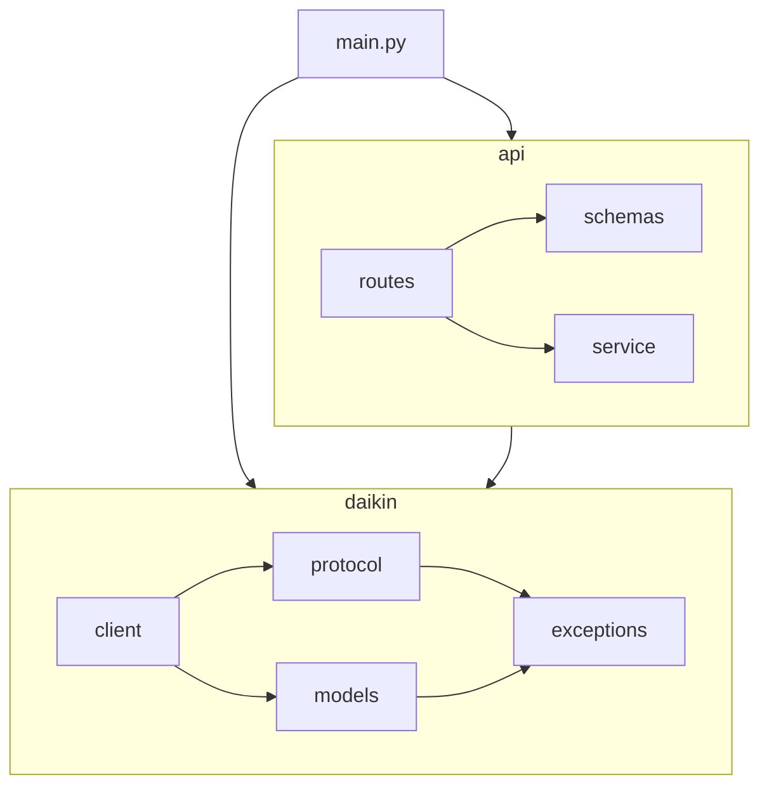

# 開発環境と運用

このリポジトリを変更する人向けに、コードの構成、使っているツール、依存の更新、CI、GitHub の設定をまとめます。

## コードの構成

`src/` の下のモジュールは `from daikin import ...` のようにトップレベルの名前で import します (`src.` は付けません)。パッケージとしてはビルドしません。

```
src/
  daikin/      本体の API のクライアント (FastAPI に依存しない)
    protocol.py  multireq の本文の組み立て、16 進のデコーダ、PropertyTree
    models.py    Course などの enum と、DeviceInfo / AirStatus などの応答モデル
    client.py    DaikinClient (通信、MCK706A のアドレス・プロパティパス・値の変換)
    exceptions.py
  api/         FastAPI 層
    routes.py    endpoint
    schemas.py   request モデル
    service.py   本体への通信を 1 件ずつ順に実行し、同時に来た同じ読み取りを 1 回にまとめる
  settings.py  環境変数の読み込み
  main.py      FastAPI アプリと、例外から HTTP status への対応
tests/         機能ごとの e2e テスト (API サーバーを起動し、fake の空気清浄機につなぐ)
```



パッケージと層の依存が矢印の向きだけであること (上の層は間の層を飛ばして下の層を import してもよい) と、fastapi・requests を直接 import できるモジュールは、`mise run lint` が `pyproject.toml` の `[tool.importlinter]` に従って検査します。`main.py` と `settings.py` 自身の import は検査されません。`api`・`daikin` の直下にモジュールを足したら、`[tool.importlinter]` の `exhaustive = true` の契約の `layers` にも足します (足さないと検査が失敗する)。

## ツール

ツールの版は `mise.toml` と `mise.lock` で、Python の依存 (ruff・ty・import-linter を含む) の版は `uv.lock` で固定しています。CI も同じ版を使います。

| ツール                                                         | 用途                                                     |
| -------------------------------------------------------------- | -------------------------------------------------------- |
| uv                                                             | Python 本体 (`.python-version`) と依存の管理             |
| ruff / ty / import-linter                                      | lint と整形 / 型検査 / 層の依存の検査 (`mise run lint`)  |
| pytest (xdist・Hypothesis)                                     | テスト (`mise run test`)                                 |
| [prek](https://github.com/j178/prek)                           | git hooks の実行 (`.pre-commit-config.yaml`)             |
| [dprint](https://dprint.dev/)                                  | json / yaml / markdown / toml / Dockerfile の整形        |
| [actionlint](https://github.com/rhysd/actionlint) + shellcheck | workflow の検査                                          |
| [zizmor](https://docs.zizmor.sh/)                              | workflow と `.pre-commit-config.yaml` のセキュリティ監査 |
| [hadolint](https://github.com/hadolint/hadolint)               | Dockerfile の検査                                        |
| [typos](https://github.com/crate-ci/typos)                     | 英単語の typo 検査 (綴りは米国英語)                      |
| [gitleaks](https://github.com/gitleaks/gitleaks)               | secret の検出                                            |
| [commitlint](https://commitlint.js.org/)                       | commit message の Conventional Commits の検査            |

### 検査の除外

lint の指摘は原因を直します。直せない誤検知だけを、理由を添えて次の場所で除外します。

| ツール    | 除外の書き方                                                                      |
| --------- | --------------------------------------------------------------------------------- |
| ruff / ty | 規則名付きの `# noqa: <code>`・`# ty: ignore[<rule>]`                             |
| hadolint  | `.hadolint.yaml` の `ignored` (Dockerfile 内の `# hadolint ignore=` は拒否される) |
| typos     | `typos.toml`                                                                      |
| zizmor    | 除外できない。指摘されたファイルを直す                                            |

Dockerfile に `LABEL` を足すときは、`.hadolint.yaml` の `label-schema` にも足します (schema に無い label は拒否される)。

### git hooks

`mise install` が `prek install` で hook を登録します。`.pre-commit-config.yaml` を変えたら `mise exec -- prek install` で登録し直します。

| タイミング              | 実行するもの                                                                                        |
| ----------------------- | --------------------------------------------------------------------------------------------------- |
| commit                  | commit するファイルの整形 (ruff・dprint)、README のタスク一覧の同期、`mise run lint`、gitleaks など |
| commit message          | commitlint (Conventional Commits の検査)                                                            |
| push                    | ファイルを書き換えない検査 (`mise run lint`・actionlint・typos など) と `mise run test`             |
| main への commit・merge | `no-commit-to-branch` が止める                                                                      |

commit 時の hook がファイルを書き換えると commit は失敗します。差分を確かめて stage し直し、commit し直します。push 時の hook は push する commit ではなく作業ツリーを検査するので、最終的な判定は PR の CI が行います。

zizmor の online audit (impostor-commit など) は GitHub の token があるときだけ走ります。ローカルで CI と同じ範囲を監査するには次を実行します。

```sh
ZIZMOR_GITHUB_TOKEN=$(gh auth token) mise exec -- zizmor --persona auditor --strict-collection --no-ignores --no-config .
```

### その他の決まり

- `.gitignore` はホワイトリスト方式です。新しいファイルを追跡するときは、対応する `!` の行を足します。
- Python の依存は `https://pypi.flatt.tech/simple/` から取得します (`pyproject.toml` の `[[tool.uv.index]]`)。`UV_DEFAULT_INDEX`・`UV_INDEX`・`UV_EXTRA_INDEX_URL` などで別の index を指定すると `uv.lock` と食い違うので、設定しないでください。

## 依存の更新

Renovate (`renovate.json`) が、Python の依存と `uv.lock`、`mise.toml` のツールと `mise.lock`、hook の `rev` と commitlint の依存、workflow の `uses:` の commit SHA、`dprint.json` の plugin を更新します。

更新 PR は月曜の朝 (Asia/Tokyo) に作られます。

| 更新の種類                                              | PR                   | merge                                            |
| ------------------------------------------------------- | -------------------- | ------------------------------------------------ |
| minor / patch / pin / digest                            | 1 つの PR にまとめる | minor / patch は公開から 7 日後、CI が通れば自動 |
| major                                                   | 個別の PR            | 人がレビューして merge                           |
| `uv.lock`・`mise.lock` の再解決 (lock file maintenance) | 別の PR              | CI が通れば自動                                  |

手で変えるときは、次のファイルを同じ commit で揃えます。

| 変えるもの                               | 一緒に変えるもの                                                                     |
| ---------------------------------------- | ------------------------------------------------------------------------------------ |
| `mise.toml` の `[tools]`                 | `mise lock` で更新した `mise.lock` (古いと CI の `mise install --locked` が失敗する) |
| 実行する Python の版 (Renovate の対象外) | `.python-version` と `Dockerfile` の `ARG PYTHON_VERSION` を同じ値にする             |
| 対応する Python の下限                   | `pyproject.toml` の `requires-python`                                                |

## CI

`.github/workflows/ci.yaml` は PR ごとに次の job を並列に実行します。main への push では実行しません (main は PR でしか変更できないため)。

| Job        | 内容                                                                                         |
| ---------- | -------------------------------------------------------------------------------------------- |
| `prek`     | `mise run pre-commit` (pre-commit の hook を全ファイルに実行) と、online audit を含む zizmor |
| `gitleaks` | commit の履歴全体の secret の検出                                                            |
| `verify`   | `mise run test`                                                                              |

## GitHub リポジトリ設定

ファイルで管理できない設定です。リポジトリの管理者が最初に一度だけ実行します (ruleset の `POST` は新規作成なので、既存の ruleset を変えるときは GitHub の画面か ruleset の ID を指定した `PUT` で行う)。required status check には `ci.yaml` の job の `name` を書きます。

```sh
REPO=msageha/daikin-air-purifier-MCK706A-W

# merge 方式: squash のみ / squash タイトルは COMMIT_OR_PR_TITLE /
# merge 後にブランチ自動削除 / wiki off
gh api -X PATCH "repos/$REPO" --input - <<'JSON'
{
  "allow_merge_commit": false,
  "allow_rebase_merge": false,
  "allow_squash_merge": true,
  "squash_merge_commit_title": "COMMIT_OR_PR_TITLE",
  "squash_merge_commit_message": "COMMIT_MESSAGES",
  "delete_branch_on_merge": true,
  "has_wiki": false
}
JSON

# main を PR 必須・CI green 必須・squash merge 限定・force push / 削除禁止・linear history にする
gh api -X POST "repos/$REPO/rulesets" --input - <<'JSON'
{
  "name": "Protect main",
  "target": "branch",
  "enforcement": "active",
  "bypass_actors": [],
  "conditions": {"ref_name": {"include": ["refs/heads/main"], "exclude": []}},
  "rules": [
    {"type": "deletion"},
    {"type": "non_fast_forward"},
    {"type": "required_linear_history"},
    {"type": "pull_request", "parameters": {
      "required_approving_review_count": 0,
      "dismiss_stale_reviews_on_push": false,
      "require_code_owner_review": false,
      "require_last_push_approval": false,
      "required_review_thread_resolution": false,
      "allowed_merge_methods": ["squash"]
    }},
    {"type": "required_status_checks", "parameters": {
      "do_not_enforce_on_create": false,
      "strict_required_status_checks_policy": false,
      "required_status_checks": [
        {"context": "prek", "integration_id": 15368},
        {"context": "gitleaks", "integration_id": 15368},
        {"context": "verify", "integration_id": 15368}
      ]
    }}
  ]
}
JSON

# secret scanning: push protection に加え、non-provider patterns も有効化する
gh api -X PATCH "repos/$REPO" --input - <<'JSON'
{
  "security_and_analysis": {
    "secret_scanning": {"status": "enabled"},
    "secret_scanning_push_protection": {"status": "enabled"},
    "secret_scanning_non_provider_patterns": {"status": "enabled"}
  }
}
JSON
```

## template との同期

workflow・hook・Renovate・dprint などの共通ファイルは [dope-corp/template](https://github.com/dope-corp/template) から取り込んでいます。`mise run template-diff` で template の main との差分を表示します。差分にはこのリポジトリ固有の変更 (Python 向けの hook、`verify` job など) も混ざるので、取り込むものは手で選びます。
